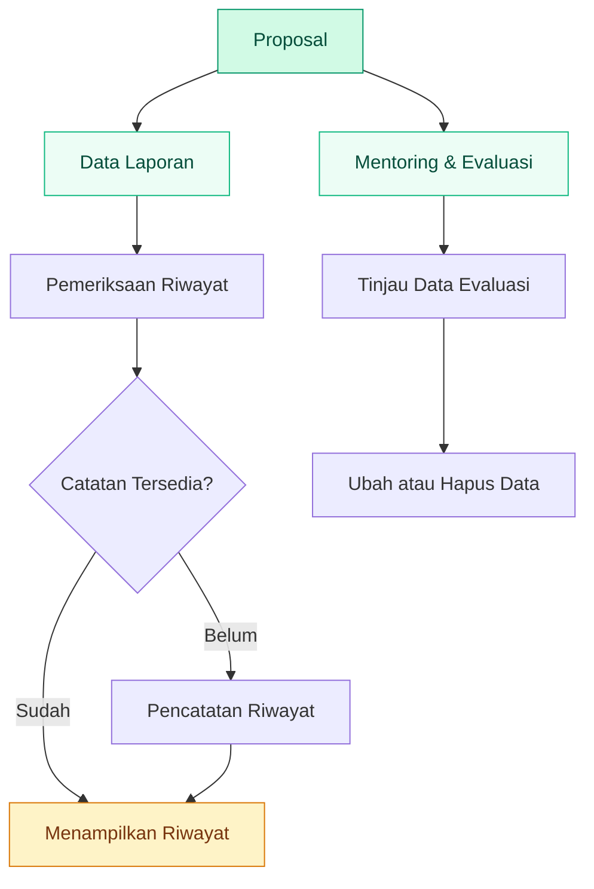

<div align="center">

# 🌱 APLIKASI PENGMAS

### Sistem Informasi Pengabdian kepada Masyarakat

**Dari Pengelolaan Proposal hingga Dokumentasi dan Evaluasi Kegiatan**

Menghadirkan pengelolaan informasi Pengabdian kepada Masyarakat yang lebih terstruktur melalui aplikasi web.

<br/>


<br/>

**📚 Administrasi Akademik &nbsp; · &nbsp; 📝 Evaluasi Kegiatan &nbsp; · &nbsp; 🤝 Pengabdian Masyarakat**

</div>

---

## ✳️ Tentang Aplikasi

Aplikasi Pengmas merupakan proyek pengembangan sistem informasi berbasis web untuk mendukung pengelolaan informasi kegiatan Pengabdian kepada Masyarakat.

Aplikasi ini mencakup pengolahan informasi mentoring dan evaluasi, data laporan, serta riwayat aktivitas yang berkaitan dengan proposal. Penggunaan sistem berbasis web diharapkan dapat membantu proses pengelolaan informasi menjadi lebih terorganisasi dan mudah ditelusuri.

Proyek ini dikembangkan sebagai proyek kelompok dengan menggunakan PHP dan MySQL.

### Identitas Proyek

| Komponen | Detail |
|---|---|
| Nama | Aplikasi Pengmas |
| Domain | Sistem Informasi Akademik dan Pengabdian Masyarakat |
| Platform | Web |
| Backend | PHP |
| Basis Data | MySQL |
| Pengembangan | Kelompok 3 |
| Kode Sumber | [Lihat repositori GitHub](https://github.com/sirajfatwasidqy/Aplikasi-Pengmas) |

---

## 🧭 Jelajahi Dokumentasi

- [Tentang Aplikasi](#-tentang-aplikasi)
- [Tujuan Pengembangan](#-tujuan-pengembangan)
- [Ruang Lingkup Fungsional](#-ruang-lingkup-fungsional)
- [Alur Pengelolaan Data](#-alur-pengelolaan-data)
- [Teknologi](#-teknologi)
- [Panduan Instalasi](#-panduan-instalasi)
- [Struktur Berkas](#-struktur-berkas)
- [Keamanan dan Pengembangan](#-keamanan-dan-pengembangan)

---

## 🎯 Tujuan Pengembangan

Pengembangan aplikasi berfokus pada pengelolaan informasi kegiatan Pengmas melalui mekanisme pencatatan dan pemrosesan data.

**Tujuan utama:**

- **Organisasi Data** — Mengelola informasi mentoring, evaluasi, dan laporan dalam struktur data yang teratur.
- **Dokumentasi Kegiatan** — Mendukung penyimpanan informasi yang berkaitan dengan proposal.
- **Penelusuran Riwayat** — Membantu pengguna meninjau catatan aktivitas yang tersedia.
- **Efisiensi Administrasi** — Mengurangi ketergantungan pada pencatatan informasi yang tersebar.
- **Pengembangan Sistem Informasi** — Menerapkan PHP dan MySQL untuk membangun aplikasi pengelolaan data berbasis web.

---

## 🧩 Ruang Lingkup Fungsional

### 01 — Mentoring & Evaluasi

Modul ini berfokus pada pengelolaan informasi mentoring dan evaluasi yang berhubungan dengan proposal.

Fungsi yang terlihat pada implementasi meliputi:

- Menampilkan daftar mentoring dan evaluasi.
- Menyajikan identitas evaluasi serta proposal terkait.
- Menampilkan informasi dosen dan P2M.
- Menampilkan status, tanggal, dan catatan evaluasi.
- Menyediakan tindakan pengubahan data.
- Menyediakan tindakan penghapusan dengan konfirmasi pengguna.

**Tabel terkait:** `mentoring_evaluasi`

### 02 — Pengelolaan Informasi Laporan

Aplikasi memiliki proses pengambilan data laporan berdasarkan identitas proposal.

Informasi yang digunakan mencakup:

- ID proposal.
- Status laporan.
- Judul laporan.
- Tanggal laporan.

Informasi ini dapat digunakan dalam proses penelusuran dan pencatatan riwayat yang terkait dengan proposal.

**Tabel terkait:** `laporan`

### 03 — Riwayat Aktivitas Proposal

Modul riwayat mendukung pencatatan dan peninjauan informasi aktivitas yang berkaitan dengan proposal.

Fungsi yang terlihat pada kode meliputi:

- Mengambil identitas proposal dari parameter permintaan.
- Menelusuri laporan terkait.
- Memeriksa keberadaan catatan riwayat.
- Menambahkan catatan apabila belum ditemukan.
- Menampilkan identitas riwayat dan proposal.
- Menampilkan keterangan aktivitas, tanggal aksi, dan status.

**Tabel terkait:** `histori_dosen`

### 04 — Pengubahan Data

Berkas yang berhubungan dengan pengubahan data antara lain:

- `edit_mentoring.php`
- `proses_edit_laporan.php`

Berkas tersebut menunjukkan adanya alur pengubahan informasi mentoring dan laporan. Detail validasi serta proses lengkapnya perlu disesuaikan dengan implementasi masing-masing berkas.

### 05 — Penghapusan Data

Berkas `delete_mentoring.php` menangani alur penghapusan data mentoring.

Pada halaman `mentoring.php`, tindakan penghapusan dilengkapi konfirmasi pengguna untuk membantu mencegah penghapusan yang tidak disengaja.

---

## 🔄 Alur Pengelolaan Data

Diagram berikut menggambarkan hubungan konseptual antara proposal, mentoring dan evaluasi, laporan, serta riwayat aktivitas.



<sub>Diagram merupakan gambaran konseptual berdasarkan proses yang terlihat pada kode, bukan representasi lengkap seluruh proses organisasi.</sub>

---

## 🛠️ Teknologi

<div align="center">

| Teknologi | Peran |
|---|---|
| **PHP** | Pemrosesan permintaan dan logika sisi server |
| **MySQL** | Penyimpanan serta pengambilan data |
| **SQL** | Pengaksesan dan manipulasi data relasional |
| **HTML** | Struktur halaman web |
| **Git** | Pengelolaan versi kode |
| **GitHub** | Penyimpanan repositori dan kolaborasi |

</div>

---

## 💻 Panduan Instalasi

### Persiapan Lingkungan

Pastikan tersedia:

- PHP.
- MySQL atau MariaDB yang kompatibel.
- Web server, seperti Apache.
- Browser modern.
- Struktur database yang sesuai dengan query aplikasi.

XAMPP dapat digunakan sebagai salah satu pilihan lingkungan pengembangan lokal.

### Langkah Menjalankan Aplikasi

**1. Kloning repositori**

```bash
git clone https://github.com/sirajfatwasidqy/Aplikasi-Pengmas.git
```

**2. Masuk ke folder proyek**

```bash
cd Aplikasi-Pengmas
```

**3. Siapkan web server**

Tempatkan folder proyek pada direktori web server lokal, misalnya `htdocs` pada XAMPP.

**4. Siapkan database**

Buat database sesuai dengan kebutuhan aplikasi. Kode yang terlihat merujuk pada database `peng_mas` dan tabel seperti:

- `mentoring_evaluasi`
- `laporan`
- `histori_dosen`

Pastikan struktur tabel, nama kolom, dan tipe data sesuai dengan query yang digunakan. Jangan mengasumsikan file SQL sudah tersedia jika belum ditemukan dalam repositori.

**5. Konfigurasikan koneksi**

Periksa berkas koneksi database dan sesuaikan host, nama database, username, serta password dengan lingkungan lokal.

**6. Jalankan aplikasi**

Aktifkan web server dan database, lalu akses direktori proyek melalui browser menggunakan alamat lokal yang sesuai dengan konfigurasi server.

---

## 🗂️ Struktur Berkas

Berkas yang teridentifikasi pada repositori mencakup:

```text
Aplikasi-Pengmas/
├── add_mentoring.php
├── delete_mentoring.php
├── edit_mentoring.php
├── history.php
├── mentoring.php
└── proses_edit_laporan.php
```

Daftar tersebut merupakan struktur parsial berdasarkan berkas yang terlihat. Periksa repositori untuk mendapatkan daftar lengkap file dan folder.

---

## 🛡️ Keamanan dan Pengembangan

Beberapa aspek yang perlu diperhatikan dalam pengembangan lanjutan:

- **Validasi Input** — Memvalidasi parameter permintaan sebelum diproses.
- **Prepared Statements** — Menggunakan query terparameterisasi untuk mengurangi risiko SQL injection.
- **Kontrol Akses** — Memastikan hanya pengguna yang berwenang dapat menjalankan operasi tertentu.
- **Perlindungan Kredensial** — Tidak menyimpan informasi koneksi database yang sensitif dalam repositori publik.
- **Integritas Data** — Menjaga konsistensi hubungan antara proposal, laporan, dan riwayat.
- **Pengujian Fungsional** — Menguji proses tambah, ubah, hapus, serta pencatatan riwayat.

Poin di atas merupakan rekomendasi pengembangan dan bukan klaim bahwa seluruh mekanisme telah diterapkan pada kode saat ini.

---

## 🌿 Potensi Pengembangan

| Area | Arah Pengembangan |
|---|---|
| Dashboard | Ringkasan informasi proposal, mentoring, dan laporan |
| Pencarian | Penyaringan data berdasarkan kriteria yang relevan |
| Pelaporan | Penyajian ringkasan informasi kegiatan |
| Basis Data | Dokumentasi relasi dan penguatan integritas data |
| Hak Akses | Pengaturan akses berdasarkan peran pengguna |
| Pengujian | Pengujian fungsional dan integrasi |
| Antarmuka | Penyempurnaan konsistensi desain dan pengalaman pengguna |

Fitur-fitur tersebut merupakan usulan untuk pengembangan berikutnya.

---

## 🤝 Kolaborasi

Proyek ini dikembangkan sebagai proyek kelompok. Pengembangan lebih lanjut dapat dilakukan melalui pengelolaan versi, dokumentasi perubahan, dan peninjauan kode untuk menjaga konsistensi fungsi aplikasi.

---

<div align="center">

### 🌱 Aplikasi Pengmas

**Teknologi untuk Mendukung Pengelolaan Pengabdian kepada Masyarakat**

[**Lihat Kode Sumber di GitHub →**](https://github.com/sirajfatwasidqy/Aplikasi-Pengmas)

<sub>Proyek Pengembangan Sistem Informasi · Kelompok 3</sub>

</div>
